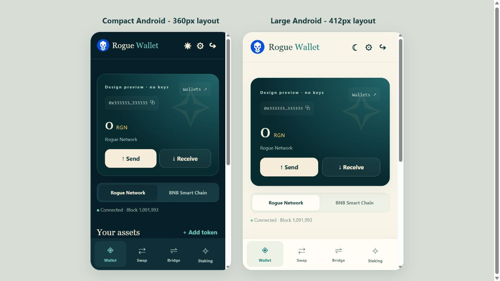

# Rogue Wallet


**Your keys. Your horizon.** A self-custody Android wallet for Rogue Network (RGN), with BNB Smart Chain support, Deepwater swaps and bridging, and the existing RGN staking contract.

This is the redesigned successor to OGG Mobile. It uses a **new Android application ID and a new signing certificate**, because the old release key was unavailable. It installs alongside the old app and cannot read the old app’s encrypted storage. It does **not** replace the old app in place.

## Install on Android

1. Download `Rogue-Wallet-3.0.0-android.apk` and `SHA256SUMS` from the release assets.
2. Check the APK checksum before installing. On Linux: `sha256sum Rogue-Wallet-3.0.0-android.apk`; on macOS: `shasum -a 256 Rogue-Wallet-3.0.0-android.apk`; on Windows PowerShell: `Get-FileHash .\Rogue-Wallet-3.0.0-android.apk -Algorithm SHA256`. Compare the result with the APK line in `SHA256SUMS`.
3. Open the APK on your phone. If prompted, permit installation from the browser/file manager you used. Restrict that permission again afterward if you wish.
4. Create a wallet and back up its private key offline, or import an existing key/standard Ethereum recovery phrase.
5. Verify your public address and network before receiving funds. Start with a small amount.

The `.aab` asset is for Android store distribution; it is not installed directly like an APK.

### Moving from OGG Mobile

Keep the old app installed. Use its existing export feature to back up your private key privately, then import it into Rogue Wallet. Confirm the **full public address** matches, then check your balance on the correct network. Existing RGN funds, wrapped tokens and staking positions remain at the same addresses/contracts; they do not need to be sent to a new chain. Do not uninstall the old app until your backup and new wallet have been verified. Never share that key or recovery phrase with support or upload it to GitHub.

## Features

| Area | Included |
|---|---|
| Wallet | Create/import, multiple encrypted wallets, send native coins and tokens, gas-aware Max, copy address and receive QR |
| Networks | Rogue Network (70088) and BNB Smart Chain (56); separate per-network balances |
| Tokens | RGN, wRGN, BNB, RGN (Legacy OGG) on BSC and USDT on BSC; add/remove custom token listings |
| Staking | Read position and pool stats; stake, start unstaking cooldown, claim, withdraw when allowed by the contract |
| Deepwater | Native RGN ↔ wRGN wrapping, router swaps, explicit approvals, slippage minimum output and price-impact estimate |
| Bridge | Both RGN/BSC directions; destination capacity checks; restart-persistent source/delivery records; optional, explicitly confirmed unwrap after incoming delivery |
| Appearance | Light by default, optional remembered dark mode; compact and large phone layouts; reduced-motion support |

**Tribe Pool and governance are removed.** No proposal/vote/finalize UI or governance transaction code is shipped. Solana/SPL is not supported by this Android release. A BSC yellow ring and “Legacy OGG” label distinguish the existing BSC token. Display aliases do not rename deployed contracts.



Design review using a keyless sample address at compact and large phone widths. These are browser previews of the packaged UI, not physical-device test results.

## Using the wallet

**Send:** select the network and asset, enter the recipient and amount, then review the full recipient, chain ID, maximum gas fee and nonce. Nothing is signed or broadcast before confirmation. Native gas is required on the source network, including for token transfers. Max keeps a conservative reserve; the final estimate is checked again.

**Receive:** choose the correct network, then use the public address or QR. The address can be the same on both EVM networks, but balances are separate. Sending a token on the wrong chain does not move it to RGN.

**Stake:** the screen reads the existing contract rather than changing its rules. Contract minimums, cooldown and withdrawal eligibility are enforced by contract calls and gas estimation. No fixed APR is promised. The old hard-coded APR assumption has been removed.

**Swap:** choose two Rogue Network assets. Review the quote, minimum received, slippage and price impact. Token approvals are exact amounts; an existing non-zero insufficient allowance is reset first. Each approval and each swap requires a separate confirmation. Swaps use the deployed router’s original ABI names, including `swapExactOGGForTokens`; these must not be renamed as part of branding.

**Bridge:** choose direction and native/wrapped asset. Outbound native RGN is wrapped first, with a separate confirmation. The bridge transaction is then reviewed separately. If wrapping confirms but bridging is cancelled, the wRGN remains in your wallet: select wRGN to continue. Incoming transfers settle as wrapped tokens; a separate confirmed unwrap can turn them into native RGN, with RGN required for gas. Capacity is checked on the destination; it does not prove relayer availability or guarantee a delivery time. The wallet does not run the bridge relayer.

### Pending transactions and recovery

The exact signed transaction hash is saved before broadcasting. A network timeout is **uncertain**, not proof of failure. The app never automatically resends or silently creates a replacement. Check Activity and the explorer before retrying. Reopen/unlock the same wallet to recover receipt status. Activity lists transactions initiated by this app; the explorer provides full chain history.

Bridge delivery requires the destination event to match the **source transaction hash, recipient and exact amount**, with at least three destination confirmations. Destination log scans resume in bounded batches. An old or slow transfer stays awaiting delivery; a timeout is not relabelled as a failed bridge. If source execution reverts, that is reported separately. Large backlogs can take multiple refresh cycles to scan.

## Android compatibility

- Minimum Android **7.0 / API 24**, target/compile API **35**.
- No native CPU-specific libraries: one APK supports supported 32-bit and 64-bit Android architectures without separate downloads.
- Layouts designed for 360px-class compact phones and 412px-class larger phones, including the screen classes used by Galaxy S8 and Galaxy S23+.
- Keep **Android System WebView / Chrome updated**. The phone’s supported OS and WebView determine available browser/cryptography features; no claim is made that every original factory WebView works.
- No camera, contacts, storage, location or microphone permissions. Receive QR is generated locally. Camera-based QR scanning and biometric unlocking are not included.
- Low-overhead HTML/CSS interface, local assets and fonts, asynchronous native RPC transport, no looping decorative video or remote signing-code CDN.

Physical S8/S23+ device tests and funded send/stake/swap/bridge settlement checks must be recorded before calling a public release fully qualified. Build and automated/read-only results are in `docs/VALIDATION.md`.

## Network and contracts

| Setting | Value |
|---|---|
| Name / symbol | Rogue Network / RGN |
| Chain ID | 70088 |
| RPC | https://rpc.rogueisles.com |
| Explorer | https://scan.rogueisles.com |
| Deepwater | https://swap.rogueisles.com |
| Atlas | https://rogueisles.com/atlas/ |
| BSC RPC | https://bsc-dataseed.binance.org |
| BSC explorer | https://bscscan.com |

| Contract | Existing address |
|---|---|
| Staking | `0xa47008c59f729756bEc7d01f6FE71328A242d0c4` |
| Router | `0x63bF06B97B6764699715A1421F65F5DBdED54008` |
| Factory | `0xeDD3931022b29F1d2EB226E978A775eE05891866` |
| Wrapped RGN (on-chain wOGG) | `0x481c52Fc0394943d3A1190e5121F63a67C072ABb` |
| RGN-side bridge | `0x9C86C959dbfD0FFe997fceF3c4b307c1a9AcFc8A` |
| BSC-side bridge | `0xb448CE16ec19882556Bea1171cA8D02774a5E49E` |
| RGN (Legacy OGG) on BSC | `0xC44Efba271E71351CE20F96cFAc2d1d5c2302Aa3` |

No fork activation settings or daemon services are changed by this app. It uses the existing network and deployed contracts.

## Build locally — GitHub Actions is optional

Requirements: JDK 17, Android SDK platform 35, build-tools 35.0.0, Gradle 8.9 (included wrapper), and Node.js 20+ for tests. Android Gradle Plugin is pinned to 8.7.3. Follow the [official AGP compatibility table](https://developer.android.com/build/releases/agp-8-7-0-release-notes).

```bash
git clone https://github.com/rogueisles/RGN-Mobile.git
cd OGG-Mobile
# Check out the Rogue Wallet release tag after its source is published.
export JAVA_HOME=/path/to/jdk-17
export ANDROID_HOME=/path/to/android-sdk
node --test tests/core.test.cjs tests/signing.test.cjs
./gradlew --no-daemon assembleDebug lintRelease
```

On Windows, use `gradlew.bat` and set environment variables using PowerShell. Gradle can use `sdk.dir` in an untracked `local.properties` file. The wrapper distribution SHA-256 is pinned in `gradle/wrapper/gradle-wrapper.properties`.

### Sign your own release

Keep the production signing keystore **outside the public repository**. Set `ROGUE_SIGNING_PROPERTIES` to an absolute private properties file containing:

```properties
storeFile=/private/path/rogue-wallet-release.jks
storePassword=YOUR_PRIVATE_STORE_PASSWORD
keyAlias=rogue-wallet
keyPassword=YOUR_PRIVATE_KEY_PASSWORD
```

Then build:

```bash
export ROGUE_SIGNING_PROPERTIES=/private/path/release-signing.properties
./gradlew --no-daemon assembleRelease bundleRelease lintRelease
# APK: app/build/outputs/apk/release/app-release.apk
# AAB: app/build/outputs/bundle/release/app-release.aab
```

Without signing configuration, a release build is unsigned. Debug builds use the development key and are not production updates. Back up the release key and passwords privately: future updates for `com.rogueisles.wallet` must retain this certificate and increase versionCode. Never upload the keystore, its passwords, `local.properties`, user wallets or private keys in a source release.

## Security design and limitations

- Local PBKDF2-SHA256 (600,000 iterations) and AES-256-GCM for new encrypted keys; tested decryption compatibility with legacy 150,000-iteration keystores. Storage is app-local; loss of the password and offline backup can make funds unrecoverable.
- The packaged UI is served on an isolated local HTTPS origin. Remote pages never enter the wallet WebView. External links open in the system browser and the wallet locks on backgrounding.
- Native RPC allows only the two configured HTTPS endpoints and the wallet’s required RPC methods, rejects redirects and limits responses. Chain ID is verified against the actual RPC before signing.
- No JavaScript CDN or analytics; pinned vendored dependencies with recorded integrity hashes and licenses. No automatic Android backups; release WebView debugging disabled; Android screenshots/recordings blocked.
- Private key export requires password re-entry and disappears after 30 seconds. Android sensitive clipboard content is marked and cleared after 60 seconds if unchanged. Other apps/keyboard/OS compromise can still expose secrets. A rooted, malicious or compromised phone is outside these protections.
- Transactions and public addresses necessarily reach the configured RPC services. This is self-custody, not anonymity, a hardware wallet or a security audit.
- Do not run the development web preview as a public hosted wallet. The supported artifact is the packaged Android app.

## Source structure

```text
app/src/main/java/com/rogueisles/wallet/MainActivity.java  Android shell and restricted async RPC
app/src/main/assets/index.html                          Packaged document and CSP
app/src/main/assets/wallet.css                          Responsive light/dark interface
app/src/main/assets/wallet.js                           Wallet, staking, swap and bridge flows
app/src/main/assets/core.js                             Network/contracts, validation, crypto helpers
app/src/main/assets/vendor/                             Pinned ethers/QR code and licenses
tests/                                                 Offline crypto/signing/recovery tests
docs/                                                  Validation and release guidance
```

## License

[MIT](LICENSE). Original OGG Mobile attribution is retained. Vendored dependencies retain their own licenses in `app/src/main/assets/vendor/`.
